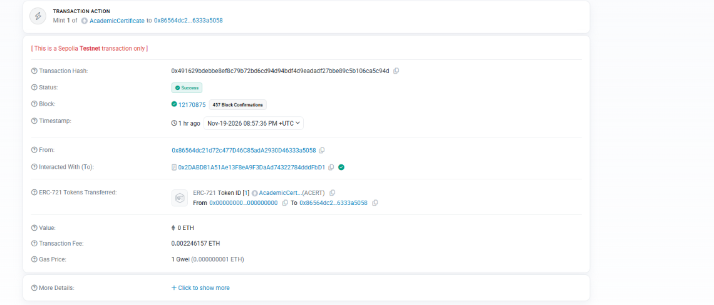
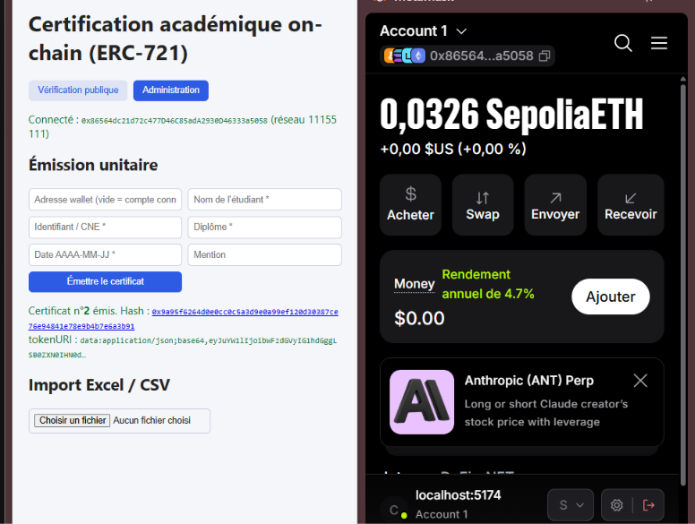
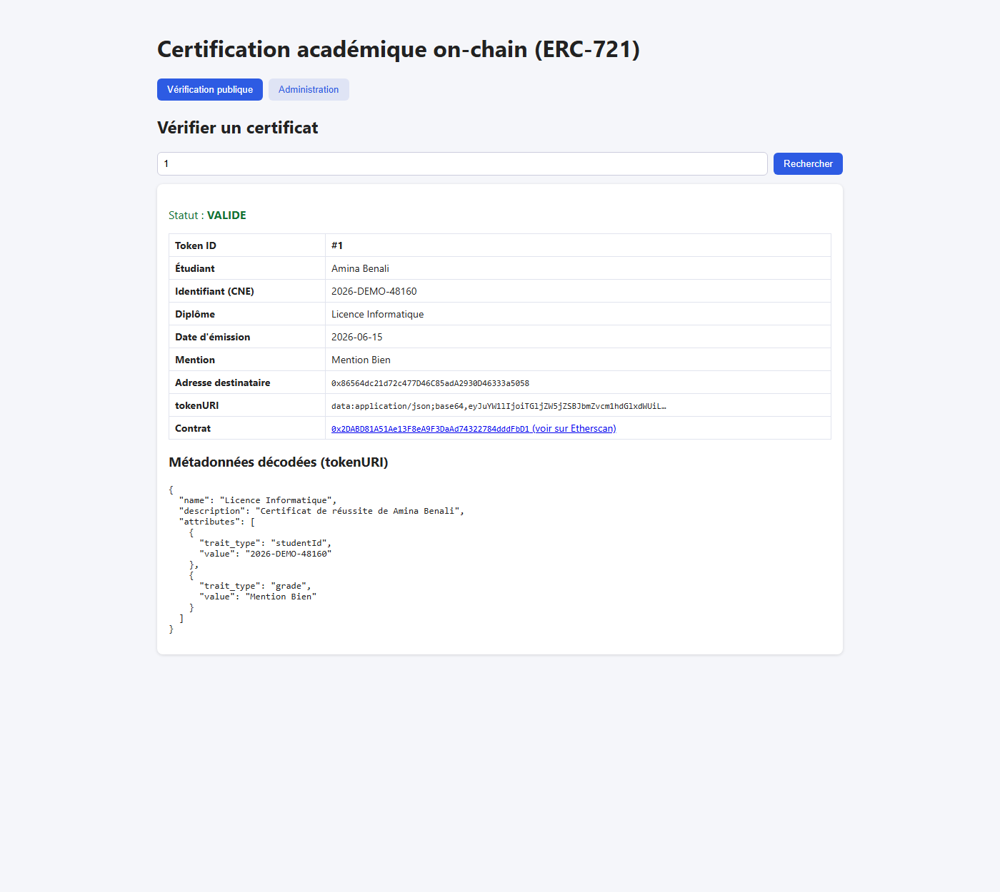
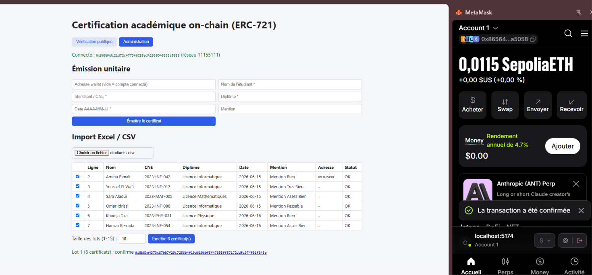
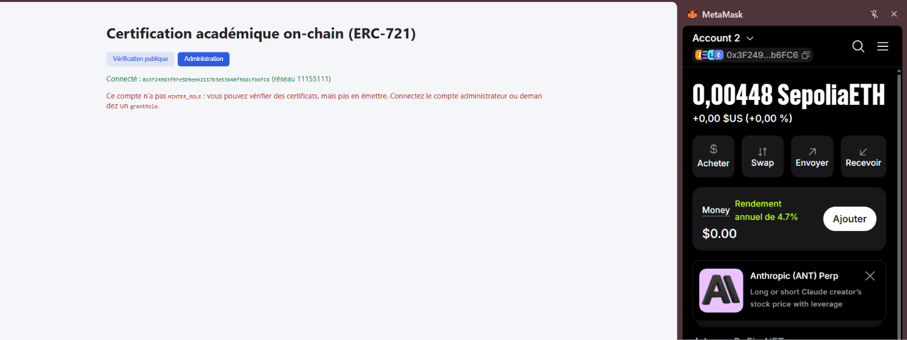
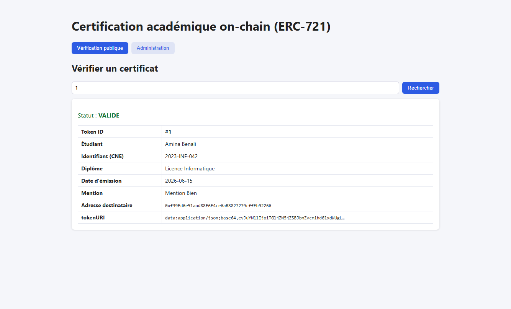

# Devoir 2 — Certification académique ERC-721 & audit

Migration du système du Devoir 1 vers le standard **ERC-721** (OpenZeppelin v5) + démarche d’audit.
Rapport d’audit : [AUDIT_REPORT.md](AUDIT_REPORT.md).

## Structure

```
contracts/   CertificateNFT.sol, mocks/ReentrantReceiver.sol
test/        CertificateNFT.test.js (13 tests)
scripts/     deploy.js (écrit adresse + chainId + ABI dans frontend/src/contract.json)
data/        etudiants.xlsx (6 étudiants d’exemple)
frontend/    React + Vite + ethers v6 + SheetJS (zones Publique et Admin)
```

## Installation

```bash
npm install
cd frontend && npm install
```

## Tests et audit

```bash
npm test
npx hardhat coverage
slither .          # facultatif (pip install slither-analyzer)
```

## Déploiement local

```bash
npm run node          # terminal 1
npm run deploy:local  # terminal 2 : met à jour frontend/src/contract.json
cd frontend && npm run dev   # terminal 3
```

MetaMask : réseau `http://127.0.0.1:8545`, chain ID `31337`, importer la clé du compte #0 Hardhat (admin **et** minter au départ).

## Déploiement Sepolia

```bash
copy .env.example .env     # renseigner SEPOLIA_RPC_URL et PRIVATE_KEY (compte de test)
npm run deploy:sepolia
```

Côté frontend, mettre `VITE_RPC_URL` dans `frontend/.env` avec votre RPC Sepolia. La clé privée reste dans `.env` (ignoré par git). Ne jamais utiliser le wallet principal.

Un certificat d’exemple peut ensuite être émis avec :

```bash
npx hardhat run scripts/mint-example.js --network sepolia
```

**État du rendu : contrat déployé et testé sur Sepolia** (voir la section suivante).

## Utilisation

- **Vérification publique** : saisir un `tokenId` (1, 2, 3…) → nom, diplôme, date, mention, destinataire, **tokenId**, **tokenURI**, statut VALIDE/REVOQUÉ. Aucun wallet requis.
- **Administration** : connecter un compte avec `MINTER_ROLE`. Si le compte ne l’a pas, un message clair est affiché et l’émission est bloquée.
  - Mint unitaire : formulaire + génération automatique de la `tokenURI` en `data:application/json;base64`.
  - Import Excel : aperçu, sélection des lignes, lots de 1 à 15, appel à `batchMintCertificates`.

## Adresse du contrat déployé sur Sepolia

- Réseau : Sepolia (chain ID 11155111)
- Adresse du contrat : [`0x2DABD81A51Ae13F8eA9F3DaAd74322784dddFbD1`](https://sepolia.etherscan.io/address/0x2DABD81A51Ae13F8eA9F3DaAd74322784dddFbD1)
- Transaction de déploiement : [`0xc27773d09245cc727dbc2e2ba5db7272cd35d31dd149b7cf4ef153d64e10e396`](https://sepolia.etherscan.io/tx/0xc27773d09245cc727dbc2e2ba5db7272cd35d31dd149b7cf4ef153d64e10e396) (bloc 12170849)
- Transaction d’exemple (mint, tokenId 1) : [`0x491629bdebbe8ef8c79b72bd6cd94d94bdf4d9eadadf27bbe89c5b106ca5c94d`](https://sepolia.etherscan.io/tx/0x491629bdebbe8ef8c79b72bd6cd94d94bdf4d9eadadf27bbe89c5b106ca5c94d) (bloc 12170875)
- Transaction de mint, tokenId 2 (via le frontend) : [`0x9a95f6264d0e0cc0c5a3d9e0a99ef120d30387ce76e94841e78e9b4b7e6a3b91`](https://sepolia.etherscan.io/tx/0x9a95f6264d0e0cc0c5a3d9e0a99ef120d30387ce76e94841e78e9b4b7e6a3b91)
- Transaction de batch, 6 certificats issus de `data/etudiants.xlsx` : [`0x8b83e4373c87bb7f29c7256b4f19a6106bf5f47898ff57172ddfc974f91f845e`](https://sepolia.etherscan.io/tx/0x8b83e4373c87bb7f29c7256b4f19a6106bf5f47898ff57172ddfc974f91f845e)
- Compte admin / minter : `0x86564dc21d72c477D46C85adA2930D46333a5058`

### Capture d’écran Etherscan (Sepolia)



### Captures du frontend connecté à Sepolia

Mint réussi depuis la zone Administration :



Vérification publique (tokenId, tokenURI, métadonnées décodées) :



Import Excel sur Sepolia (lot de 6 certificats confirmé) :



Gestion de l'erreur de rôle (compte sans `MINTER_ROLE`, l'émission est bloquée avec un message clair) :



### Preuves du déploiement local (Hardhat)

- Adresse locale (chain ID 31337) : `0xDc64a140Aa3E981100a9becA4E685f962f0cF6C9`
- Transaction locale de déploiement : `0xe71d6314e8d506a1de5f42906f5e0e8b1911c5407140da42e68f15a82bb6ab35`
- Transaction locale de mint de démonstration : `0xd43b77a4b4e7e00b35e0aeba2707cc7f9348dc6fad9c9f2a09efc39a2819f0b1` (tokenId 1)

Ces valeurs locales (Hardhat) complètent les preuves Sepolia ci-dessus ; elles ne sont pas consultables sur Etherscan.

### Capture d'écran d'un mint réussi en local (Hardhat)


